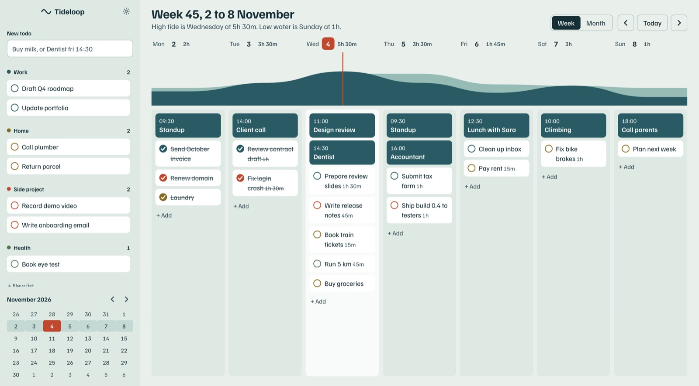
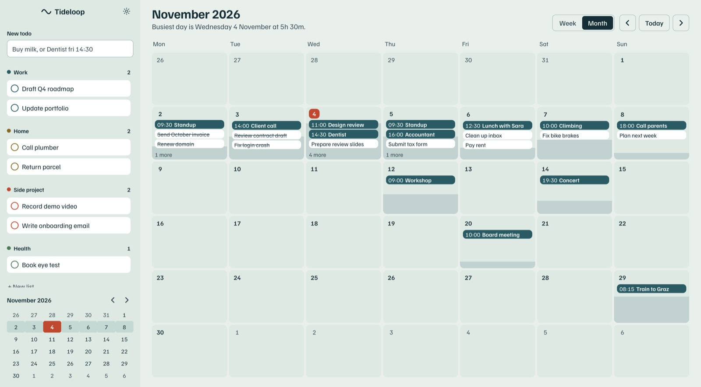
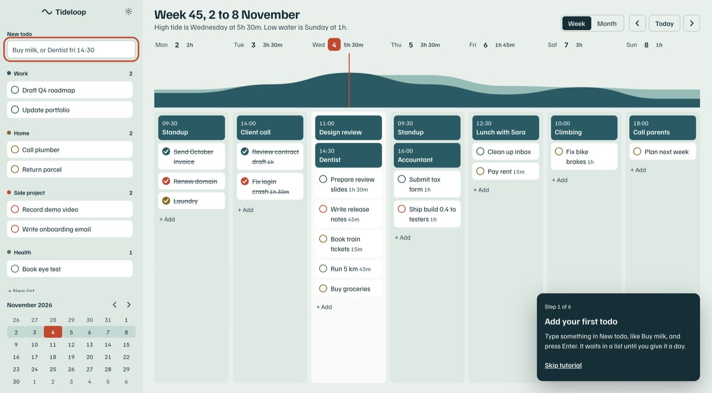
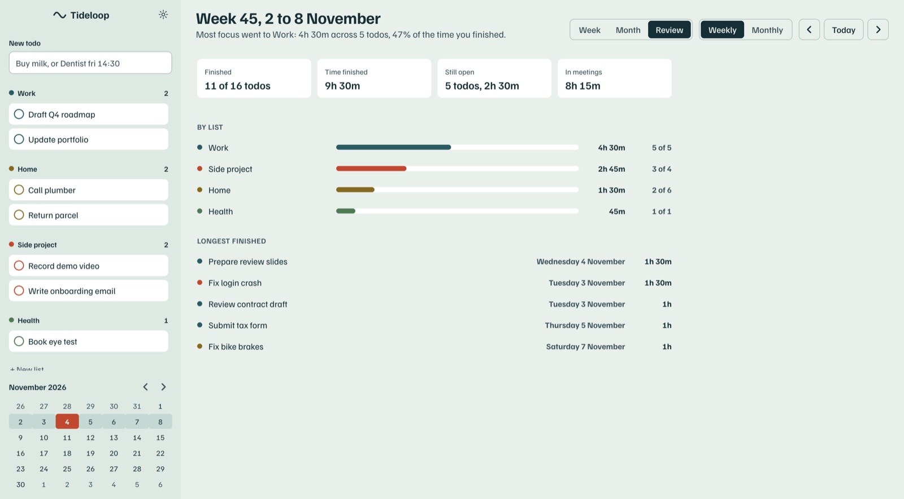
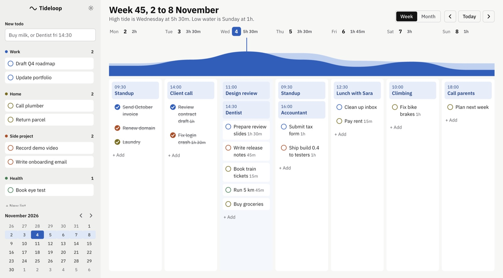
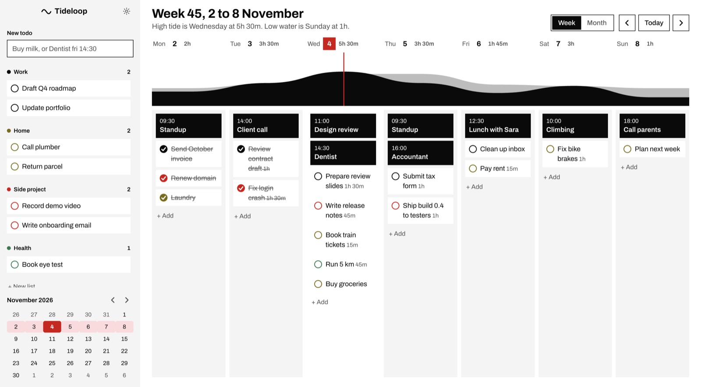
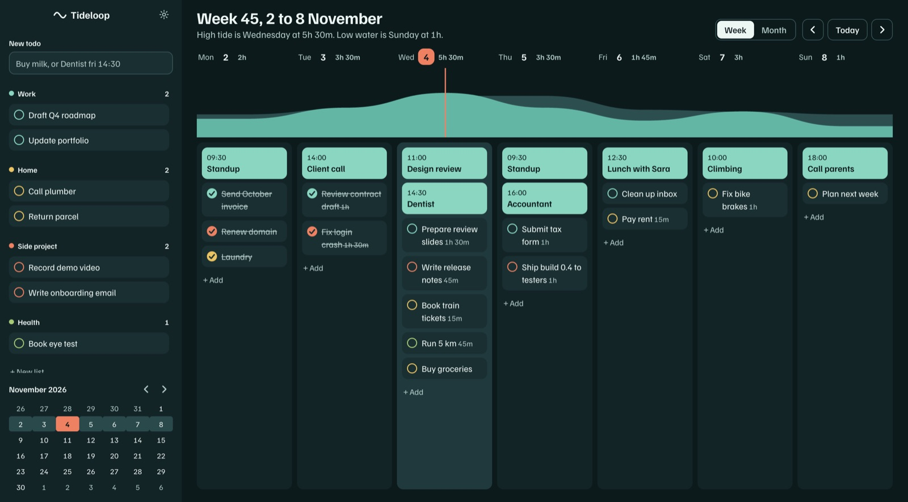
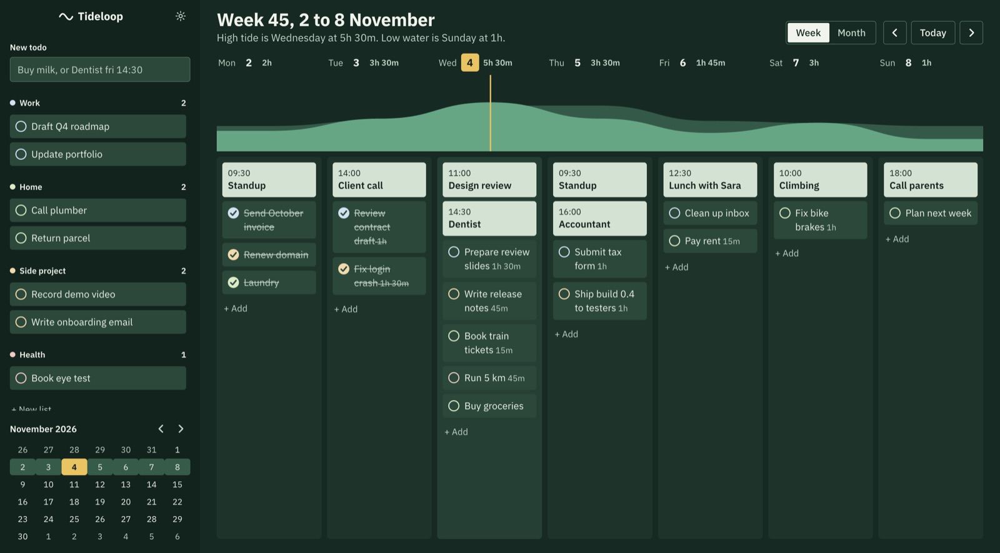
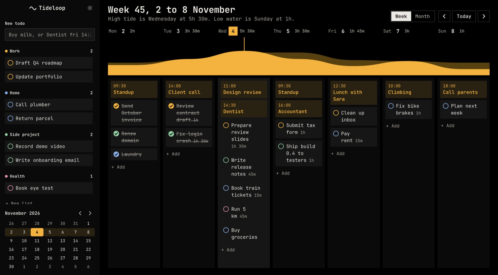
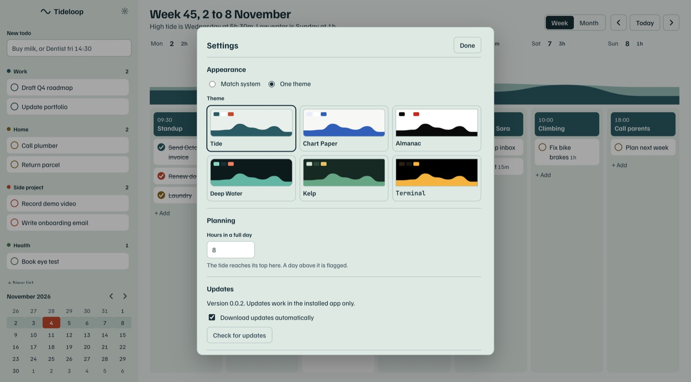

<h1 align="center">Tideloop</h1>

<p align="center">
  A week planner for macOS with a tide chart on top.<br>
  The water shows how full each day is. Todos drag between lists and days.
</p>

<p align="center">
  <a href="https://github.com/jafforgehq/Tideloop/actions/workflows/ci.yml"></a>
  <a href="https://github.com/jafforgehq/tideloop-app/releases/latest"></a>
  <a href="LICENSE"></a>
</p>

<p align="center">
  
</p>

## Download

Get the latest `.dmg` from the [Tideloop page](https://jafforgehq.github.io/tideloop-app/) or the [releases](https://github.com/jafforgehq/tideloop-app/releases/latest). There is one for Apple silicon and one for Intel. Every build is signed with a Developer ID and notarized by Apple, and the app updates itself.

Tideloop runs on macOS only. Your plans stay on your Mac in one JSON file. The app makes no network calls except to check for updates.

## What it does

- **Week view with a tide chart.** Each day's planned time raises the water. A full day reaches the top, so you see an overloaded Thursday before you commit to it. Set how long a full day is in Settings.
- **Todo lists beside the week.** Drag a todo from a list onto a day, between days, or back to a list. Everything also works from the keyboard: `⌥→` and `⌥←` move the selected todo to the next or previous day, `⌥↑` and `⌥↓` reorder it.
- **Month view** for the longer look ahead, with the same drag and drop.
- **Weekly and monthly review.** See where your finished time went: which lists got the most, how much you finished against what you planned, and your longest todos. A todo counts on the day it is planned for.
- **Quick add.** Type `Dentist fri 14:30 45m #health` in New todo. A time makes it an event on the calendar. A day word, a duration and a `#list` are picked up, and anything unclear stays in the title. `Buy milk` just goes in a list.
- **Six themes**, with a separate pick for system light and dark. Every theme is checked against WCAG contrast in the tests.
- **A short tutorial on first run** that uses your own first todo. Skip it any time, replay it from Settings.
- **Undo** with `⌘Z`.
- **Claude Code integration.** An optional local MCP server lets Claude Code read and edit your planner. See [below](#claude-code).

<p align="center">
  
  
</p>
<p align="center">
  
</p>

### Themes

<p align="center">
  
  
  
</p>
<p align="center">
  
  
  
</p>

## Claude Code

Turn on **Settings → Claude Code** in the app and run the command it copies. It looks like this:

```bash
claude mcp add --transport http --scope user tideloop http://127.0.0.1:47613/mcp \
  --header "Authorization: Bearer <your token>"
```

The server is off by default. When on, it listens on `127.0.0.1:47613` only while the app is open, requires the bearer token, and rejects requests with a foreign `Host` or `Origin`. Generate a new token in Settings if you ever paste the old one somewhere you should not have.

| Tool | What it does |
| --- | --- |
| `get_week`, `get_days` | Read a week or a date range with events, todos and booked minutes |
| `list_todos`, `list_lists` | Read todos (filter by list, date, done) and lists |
| `add_todo`, `update_todo`, `delete_todo` | Create, move to a day, edit or remove todos |
| `move_overdue_to_today` | Move every unfinished todo from past days to today |
| `add_event`, `update_event`, `delete_event` | Calendar events at a fixed time |
| `add_list`, `rename_list`, `delete_list` | Manage lists |

Claude reads your todo titles and notes, so treat them like any text you paste into a chat: a note copied from somewhere untrusted could try to steer it. The token can delete things, and `⌘Z` in the app undoes it. The token is also visible in shell history after you run the command above.

Then ask Claude things like "what does my Thursday look like?" or "move everything overdue to today".

## Build from source

You need Node 22 or newer and macOS.

```bash
git clone https://github.com/jafforgehq/Tideloop.git
cd Tideloop
npm install
npm run dev              # run the app with hot reload
npm test                 # unit tests
npm run e2e              # end-to-end tests against a real Electron window
npm run typecheck
npm run dist:unsigned    # a local arm64 package, not signed
```

An unsigned build will not start on Apple silicon until it is ad-hoc signed, because the Electron fuses change the binary:

```bash
codesign --force --deep --sign - dist/mac-arm64/Tideloop.app
```

To regenerate the screenshots in `docs/screenshots`: `npm run build && SHOTS=out/shots npx playwright test shots`.

### How it is put together

- `src/shared`: the planner rules as one pure reducer, plus dates, the tide, themes, quick add and the tutorial. No Electron, fully unit tested.
- `src/main`: the Electron process. The main process owns the data. The renderer applies actions optimistically and the main process's state always wins. Saves are atomic, and undo lives in the main store.
- `src/preload`: the narrow API the window gets.
- `src/renderer`: the React UI. Drag and drop is native HTML5.
- `page`: the source of the public download page.

## Releasing

Releases are automatic. Bump `version` in `package.json`, add a section to `CHANGELOG.md`, and push to `main`. CI tests the push. If that version has no public release yet, it builds arm64 and x64, signs and notarizes them, refuses to continue unless `scripts/verify-release.sh` passes, publishes the files to [`tideloop-app`](https://github.com/jafforgehq/tideloop-app), and updates the download page. Installed apps pick the release up on their own.

Forks do not need any of this. The signing secrets are set once with `scripts/setup-ci-secrets.sh`:

| Secret | What it is |
| --- | --- |
| `CSC_LINK` | The Developer ID Application certificate as a base64 `.p12` |
| `CSC_KEY_PASSWORD` | The password of that `.p12` |
| `APPLE_APP_SPECIFIC_PASSWORD` | An app-specific password for the Apple ID set in `ci.yml` |
| `RELEASES_TOKEN` | A fine-grained GitHub token with Contents: write on `tideloop-app` only |

## Contributing

Issues and pull requests are welcome. Read [CONTRIBUTING.md](CONTRIBUTING.md) first. To report a security problem, follow [SECURITY.md](SECURITY.md).

## License

[MIT](LICENSE) © 2026 Feda Hadziselimovic
